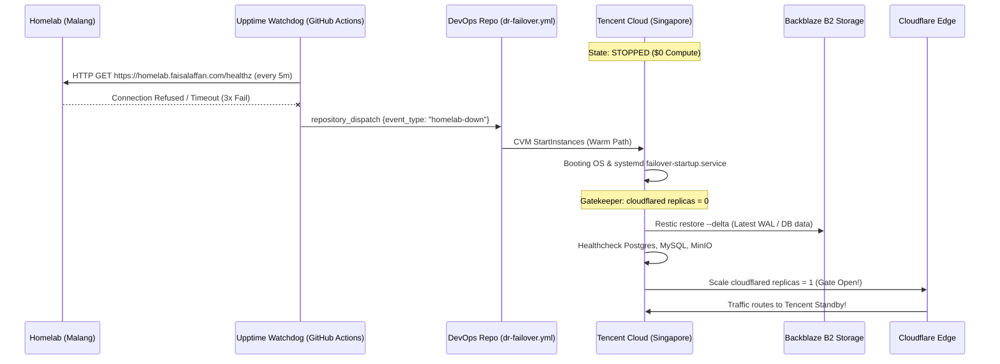

# Panduan Setup Upptime & Automated DR Failover Trigger (Zero Cost)

Dokumen ini menjelaskan cara menghubungkan **Upptime** (GitHub Actions monitoring gratis) dengan repositori DevOps Anda untuk memicu failover otomatis ke **Tencent Cloud Standby** saat Homelab offline.

---

## 1. Arsitektur Komunikasi



---

## 2. Cara 1: Setup Upptime di Repositori Terpisah (Standar Resmi Upptime)

Jika Anda membuat repo status page baru bernama `upptime` (rekomendasi agar status page publik tidak bercampur kode infra devops):

1. Buat repositori baru di GitHub dari template: [upptime/upptime](https://github.com/upptime/upptime).
2. Edit file `.upptimerc.yml` di repo Upptime Anda:

```yaml
owner: faisalaffan
repo: upptime

sites:
  - name: Homelab Malang
    url: https://homelab.faisalaffan.com/healthz
    method: GET
    expectedStatusCodes:
      - 200
    maxResponseTime: 10000

# Pengaturan Notifikasi / Webhook
status-website:
  cname: status.faisalaffan.com
  theme: dark
```

3. Di repo `upptime`, buat file workflow `.github/workflows/trigger-failover.yml`:

```yaml
name: Trigger DR Failover on Homelab Outage

on:
  issues:
    types: [opened]

jobs:
  notify-devops:
    if: contains(github.event.issue.labels.*.name, 'status') && contains(github.event.issue.title, 'Homelab Malang')
    runs-on: ubuntu-latest
    steps:
      - name: Dispatch Event to DevOps Repository
        run: |
          curl -X POST \
            -H "Accept: application/vnd.github.v3+json" \
            -H "Authorization: token ${{ secrets.GH_PAT || secrets.DEVOPS_DISPATCH_PAT }}" \
            https://api.github.com/repos/faisalaffan/infra-light/dispatches \
            -d '{"event_type":"homelab-down","client_payload":{"reason":"Homelab down detected by Upptime"}}'
```

> **Catatan Secret:**
> Buat Personal Access Token (PAT) di GitHub dengan scope `repo` dan simpan sebagai secret `DEVOPS_DISPATCH_PAT` di repo Upptime.

---

## 3. Cara 2: Watchdog Ringan Tanpa Repo Tambahan (GitHub Scheduled Action)

Jika Anda **tidak ingin membuat repo tambahan**, Anda bisa menggunakan workflow cron watchdog langsung di dalam repositori `DEVOPS` ini!

File workflow: `.github/workflows/homelab-heartbeat-watchdog.yml`
Workflow ini berjalan otomatis setiap 5 menit via GitHub Actions free runner:
1. Melakukan `curl` ke `https://homelab.faisalaffan.com/healthz`.
2. Jika gagal 3x berturut-turut, memanggil workflow failover `dr-failover.yml`!

---

## 4. Setup Endpoint Healthcheck di Homelab

Pastikan endpoint `/healthz` dapat diakses dari internet via Cloudflare Tunnel:
- Homelab Ingress Nginx sudah mengekspos endpoint liveness/readiness K3s atau pod `system-health`.
- Untuk verifikasi:
  ```bash
  curl -I https://homelab.faisalaffan.com/healthz
  # Output yang diharapkan: HTTP/2 200
  ```

---

## 5. Menjalankan Failover Manual Kapan Saja

Anda dapat menjalankan failover kapan saja langsung dari browser:
1. Buka repositori **DEVOPS** di GitHub.
2. Klik tab **Actions** -> pilih workflow **Automated DR Failover Sentinel (Tencent Standby)**.
3. Klik **Run workflow**:
   - `action`: `auto` (otomatis deteksi warm start atau cold terraform)
   - `environment`: `prod`
   - `provider`: `tencent`
4. Selesai! Standby akan aktif dalam waktu ~60 detik.
